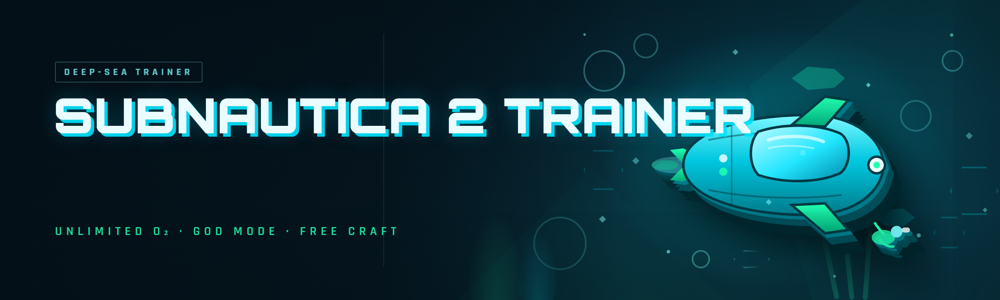

  
  
  

  

  
  
  

---

## 🧭 Table of Contents

- [Usage Guidelines](#-usage-guidelines)
- [The Problem](#-the-problem)
- [Comparison](#-comparison)
- [Key Features](#-key-features)
- [What Is a Subnautica 2 Trainer?](#-what-is-a-subnautica-2-trainer)
- [Tips for Best Results](#-tips-for-best-results)
- [Known Issues](#-known-issues)
- [Hotkeys / Controls](#-hotkeys--controls)
- [All Modules Status](#-all-modules-status)
- [AI Integration](#-ai-integration)
- [System Requirements](#-system-requirements)
- [Installation](#-installation)
- [Grouped Module Catalog](#-grouped-module-catalog)
- [FAQ](#-faq)

---

## 🧾 Usage Guidelines

Single-player sandbox only. Subnautica 2 Trainer is a memory-reading / memory-writing trainer for the **offline, solo** campaign and Creative mode. It does not touch multiplayer, co-op lobbies, or any live-service surface.

**Allowed**

- Offline single-player survival runs and Creative mode experimentation
- Testing base layouts, depth limits, and vehicle handling without grind
- Screenshot / video capture runs where you want a clean godmode HUD
- Modding research — reading entity IDs, biome spawn tables, and blueprint flags
- Speedrun routing practice with fast-travel and instabuild on

**Not allowed**

- Any multiplayer, co-op, or shared-world session
- Streaming the trainer overlay into a competitive or monetized "legit" run without disclosure
- Redistribution of the .exe behind a paywall or "premium" reskin
- Using it to attack, farm, or grief other players in any shared environment

> Educational / hobbyist modding project. You are responsible for how you run it. Back up your save folder before the first launch.

---

## 🩹 The Problem

- **Grind wall at depth 900+.** You spend four hours collecting magnetite and aerogel before you can even *see* the mid-game biomes. The trainer kills the grind, not the exploration.
- **Paid trainers that cost more than the game.** Most Subnautica 2 trainers on the market are $15–$40 subscriptions that phone home and die every patch. This one is a single .exe with a static offset table.
- **Base-building is a clicking simulator.** Placing 200 reinforcement panels by hand is not gameplay. Instabuild + no-cost placement turns a 40-minute chore into 4 minutes.
- **Vehicle handling is unforgiving.** The new submersible pressure model punishes a single bad pitch input at crush depth. Freeze-depth and vehicle godmode let you actually learn the handling curve.
- **Oxygen and hunger micromanagement kills immersion.** Every 90 seconds you're surfacing instead of exploring. Infinite O2 / no-hunger flags exist for exactly this reason.
- **Save corruption after a crashed trainer session.** Cheap trainers hook mid-write and nuke the save. This one snapshots the player struct before every write.
- **No way to test endgame gear early.** You want to theorycraft a thermal-knife build at hour 2, not hour 40.

---

## ⚖️ Comparison

| Aspect | Paid Trainer Alternative | This Tool |
|---|---|---|
| Price | $15–$40 subscription | Free, MIT-style hobby license |
| Update cadence | Waits for patch, sometimes weeks | Static offset table updated within days of a Subnautica 2 patch |
| Anti-cheat interference | Aggressive byte-pattern scan of game process | External read/write, no DLL injection by default |
| Save safety | Writes live without snapshot | Player-struct snapshot + auto-restore on crash |
| Feature breadth | 8–12 toggles | 23 modules across 5 categories |
| Distribution | Closed binary + account login | Standalone .exe, no account, no telemetry |
| Source transparency | Obfuscated | Offset table documented, community PRs accepted |
| Compatibility | One Steam build | Steam + Epic + Xbox app (offline) |

---

## 🎯 Key Features

| Feature | Description | Benefit |
|---|---|---|
| Godmode | Freezes health, hunger, thirst, radiation, and crush damage flags | Explore the deepest trenches without a death screen |
| Infinite Oxygen | Pins the O2 counter above zero and suppresses the drowning tick | No more 90-second surface runs |
| Instabuild | Skips the placement animation and material cost on all habitat pieces | Build a full base in one sitting |
| No Craft Cost | Blueprints complete without consuming inventory items | Test endgame gear at hour 2 |
| Item Spawner | Spawns any known item ID into the player inventory | Grab a thermal knife the moment you want one |
| Vehicle Godmode | Locks submersible hull integrity and disables crush depth | Learn sub handling without losing a 6-hour run |
| Freeze Depth | Pins the player's Y-axis so you can hold a depth while filming | Great for screenshots and depth-limit tests |
| Teleport | Waypoint teleport across all unlocked biomes and the new surface hub | Cuts travel time to near-zero |
| Speed Multiplier | 1x–10x swim and walk speed slider | Traverse the map in a fraction of the time |
| No Fall / No Crush | Disables fall damage and instant-crush pressure events | Safe vertical exploration |
| Stat Editor | Live editing of health, O2, food, water, and temperature | Fine-tune survival without toggling modules |
| Blueprint Unlocker | Marks all locked blueprints as researchable | Skip the fragment hunt entirely |

---

## 🧠 What Is a Subnautica 2 Trainer?

| Term | Explanation |
|---|---|
| Trainer | A small external program that reads and writes the game's process memory to alter player stats, flags, and inventory. |
| Offset table | A versioned list of memory addresses for player struct, inventory struct, and blueprint flags. Must match the current Subnautica 2 build. |
| Player struct | The in-memory block holding health, O2, hunger, thirst, radiation, position, and equipped item ID. |
| Freeze / pin | Continuously writing a fixed value to an address so the game's own tick can't overwrite it. |
| Instabuild | A write that skips the placement validation and material-cost check on habitat pieces. |
| Snapshot | A read-only copy of the player struct taken before any write, kept in memory for crash recovery. |
| External mode | Reading/writing via OS-level process handles instead of injecting a DLL — lower detection surface, slower per-tick. |

**Why people use a trainer here**

- The Subnautica 2 survival loop is deliberately slow; the trainer compresses the parts you don't enjoy.
- Base-building, vehicle handling, and blueprint hunting are the three biggest time sinks — three of the five module categories target exactly those.
- A free, offset-table-based trainer is easier to audit than a paid closed binary.
- The new crush-depth model is punishing — freeze-depth and vehicle godmode are the only sane way to learn it.

---

## 💡 Tips for Best Results

- Launch the game first, load into a save, **then** run the .exe. Attaching before the player struct is populated returns all-zero addresses.
- Run the .exe as administrator — the process handle open will fail silently otherwise on some Windows 11 builds.
- Snapshot the save folder before the first session. The trainer has crash recovery, but belt and suspenders.
- If a module stops working after a Subnautica 2 patch, check the offset table version in the footer of the .exe window — a stale table means no writes land.
- Use **external mode** (default) unless you need the per-tick speed of injected mode for speed multipliers above 5x.
- Don't combine **speed multiplier** with **teleport** in the same input frame — the position write can desync the collision mesh and leave you clipped inside terrain.
- Disable the trainer overlay before capturing screenshots if you want a clean frame.

---

## 🐛 Known Issues

| Issue | Fix |
|---|---|
| Modules show "attached" but nothing changes in-game | Offset table is stale for your Subnautica 2 build — update the .exe to the latest release |
| Speed multiplier above 6x causes terrain clipping | Drop to 4x or enable **no-clip** before going higher |
| Item spawner rejects certain endgame IDs | Some IDs are lazily loaded — spawn a base item first, then the endgame one |
| Vehicle godmode doesn't apply to the new surface skiff | Skiff uses a different hull struct; toggle vehicle godmode **after** boarding, not before |
| Overlay disappears in fullscreen exclusive | Switch Subnautica 2 to borderless windowed — overlay renders fine there |
| Crash on alt-tab with injected mode active | Use external mode for long sessions, or detach before alt-tabbing |

---

## ⌨️ Hotkeys / Controls

| Key | Action | Notes |
|---|---|---|
| F1 | Toggle overlay | Hides the whole trainer HUD |
| F2 | Toggle godmode | Health + hunger + thirst + radiation |
| F3 | Toggle infinite oxygen | Independent of godmode |
| F4 | Toggle instabuild | Applies to habitat pieces only |
| F5 | Open item spawner | Type ID, Enter to inject |
| F6 | Quick teleport to waypoint | Uses the last waypoint you set in the map |
| F7 | Cycle speed multiplier | 1x → 2x → 4x → 6x → 8x → 10x |
| F8 | Snapshot player struct | Manual save of the pre-write state |
| F9 | Restore from snapshot | Rolls back all live writes for the current session |
| F12 | Emergency detach | Releases the process handle immediately |

---

## 📋 All Modules Status

| Module | Status | Description |
|---|---|---|
| Godmode | ✅ Working | Freezes all survival damage flags |
| Infinite Oxygen | ✅ Working | Pins O2 above zero |
| Instabuild | ✅ Working | Skips placement + material cost |
| No Craft Cost | ✅ Working | Blueprints complete for free |
| Item Spawner | ✅ Working | Inject any known item ID |
| Vehicle Godmode | ✅ Working | Hull integrity locked |
| Freeze Depth | ✅ Working | Pins Y-axis at held depth |
| Teleport | ✅ Working | Waypoint cross-biome |
| Speed Multiplier | ✅ Working | 1x–10x slider |
| No Fall Damage | ✅ Working | Disables fall events |
| No Crush | ✅ Working | Suppresses pressure crush |
| Stat Editor | ✅ Working | Live edit of 5 stats |
| Blueprint Unlocker | ✅ Working | Unlocks all researchable |
| Radiation Immunity | ✅ Working | Ignores radiation tick |
| Temperature Immunity | ✅ Working | Ignores thermal tick |
| No Hunger / Thirst | ✅ Working | Suppresses both meters |
| No Clip | ✅ Working | Free-fly through terrain |
| Fast Scan | ✅ Working | Instant fragment scan |
| Beacon Unlocker | ✅ Working | All beacons visible |
| Base Integrity Lock | ✅ Working | Hull strength pinned |
| Power Cell Infinite | ✅ Working | Vehicle/facility power pinned |
| Weather Toggle | ✅ Working | Force clear underwater fog |
| Save Snapshot | ✅ Working | Manual pre-write snapshot |

---

## 🤖 AI Integration

Subnautica 2 Trainer ships with an optional local AI layer that reads the same offset table the trainer uses, then surfaces suggestions — no network calls, no account, no telemetry.

- **Adaptive offset resolver.** On attach, the trainer reads the game build hash and asks the bundled local model to rank candidate offsets from a compact offset map. It cuts manual offset hunting from minutes to seconds after a patch.
- **Save-state summarizer.** The trainer dumps the current player struct to a local JSON snapshot; the AI layer summarizes "what's changed since last session" so you know which modules you left on.
- **Blueprint suggestion engine.** Given your current inventory and depth, the AI layer suggests which blueprints are worth unlocking next for the biome you're heading into.
- **Anomaly warnings.** The AI layer watches the player struct for values that look like a pending crash (NaN position, negative O2, invalid item IDs) and warns you before the game does.
- **Natural-language module control.** Type "lock my oxygen" or "freeze at 400 meters" in the trainer console and the local model maps it to the right module toggle. Nothing leaves your machine.

All AI features are **opt-in** and run against a small quantized model bundled with the .exe. If you don't want them, uncheck "Enable local AI" on first launch — the trainer works exactly the same without it.

---

## 🖥️ System Requirements

| Component | Minimum | Recommended |
|---|---|---|
| OS | Windows 10 21H2 (64-bit) | Windows 11 24H2 (64-bit) |
| CPU | 4-core / 2.8 GHz | 6-core / 3.6 GHz+ |
| RAM | 8 GB | 16 GB |
| GPU | 4 GB VRAM (Subnautica 2 min spec) | 8 GB VRAM |
| Storage | 200 MB for the .exe + snapshots | SSD with 1 GB free |
| Runtime | .NET 8 Desktop Runtime | .NET 8 Desktop Runtime |
| Privileges | Standard user (read-only modules) | Administrator (all write modules) |
| Game | Offline single-player save loaded | Same |

---

## 📥 Installation

1. **Visit the project page** — grab the latest .exe release archive. No pip, npm, or git clone.
2. **Extract** the archive to a folder outside `Program Files` (e.g. `C:\Tools\sn2-trainer\`). Windows Defender will flag any external memory-writer — allow it in your AV, or add the folder to exclusions.
3. **Run the .exe** — right-click → Run as administrator for the first session.
4. **Launch Subnautica 2**, load into a save. Wait until the player is on-foot and the HUD is visible.
5. **Attach** the trainer from its window (or press F1 to bring up the overlay, then click Attach). The status line should read `attached — <build hash>`.
6. **Toggle modules** with the hotkeys above, or use the module list in the trainer window.

---

  

---

## 🗂️ Grouped Module Catalog

### 🗡️ Combat & Survival

| Feature | Effect |
|---|---|
| Godmode | Freezes health, hunger, thirst, radiation, and crush damage |
| No Fall Damage | Disables fall event when you jump off a habitat ledge |
| No Crush | Suppresses the instant-crush pressure event at depth |
| Radiation Immunity | Ignores the radiation tick inside the new reactor biomes |
| Temperature Immunity | Ignores thermal tick near lava vents |
| No Hunger / Thirst | Suppresses both survival meters |

### 🏗️ Base Building & Crafting

| Feature | Effect |
|---|---|
| Instabuild | Skips placement animation + material cost |
| No Craft Cost | Blueprints complete without consuming inventory |
| Base Integrity Lock | Pins hull strength so deep bases don't implode |
| Blueprint Unlocker | Marks all locked blueprints as researchable |
| Power Cell Infinite | Pins vehicle and facility power to full |

### 🚢 Vehicle & Handling

| Feature | Effect |
|---|---|
| Vehicle Godmode | Locks submersible hull integrity |
| Freeze Depth | Pins Y-axis so you can hold depth while filming |
| Speed Multiplier | 1x–10x slider on swim/walk/vehicle speed |
| No Clip | Free-fly through terrain (use before speed > 6x) |

### 🧭 Navigation & Exploration

| Feature | Effect |
|---|---|
| Teleport | Waypoint cross-biome travel |
| Beacon Unlocker | All beacons visible on the map |
| Fast Scan | Instant fragment scan |
| Weather Toggle | Force-clear underwater fog for clean captures |

### 🎒 Inventory & Items

| Feature | Effect |
|---|---|
| Item Spawner | Inject any known item ID into inventory |
| Stat Editor | Live edit of health, O2, food, water, temperature |
| Save Snapshot | Manual pre-write snapshot of the player struct |

---

## ❔ FAQ

| Question | Answer |
|---|---|
| Does this work in multiplayer or co-op? | No. Subnautica 2 Trainer is single-player, offline-only. Do not use it in any shared-world session. |
| Will it break my save? | Not normally — the trainer takes a snapshot before every write and can restore it with F9. Still, back up your save folder before the first launch. |
| How often does it update after a Subnautica 2 patch? | The offset table is updated within days of a public patch. A stale table means writes silently no-op until you grab the new .exe. |
| Is the .exe detected by anti-cheat? | It's an external read/write tool with no DLL injection by default. Steam's standard anti-cheat doesn't flag it in offline mode. Nothing here is a guarantee — you accept the risk. |
| Do I need Python, Node, or git? | No. Download the archive, extract, run the .exe. That's it. |
| Does it work on Epic and Xbox app versions? | Yes, for the offline campaign. Attach after the player is loaded and on-foot. |
| Why does the overlay vanish in fullscreen? | Subnautica 2's exclusive fullscreen path bypasses the overlay. Switch to borderless windowed. |
| What are the AI features? | Optional, local-only helpers that resolve offsets, summarize your save state, and translate natural-language module commands. Disabled by default. |
| Can I run it without admin? | Yes, but write modules will fail silently. Read-only modules (stat editor viewing, blueprint list) work without elevation. |
| Where do I report a broken module? | On the project page's issue tracker. Include your Subnautica 2 build hash — it's shown in the trainer footer. |

---

The Subnautica 2 Trainer exists because the paid alternatives were slower to patch, noisier on the process, and worse about save safety. Everything above is the result of a year of building the version I wanted to use: a single .exe, a documented offset table, snapshot-before-write, and 23 modules that target the parts of Subnautica 2's loop that eat the most hours. Grab the archive, extract it, run it, and keep your save folder backed up — that's the whole ritual.

  

